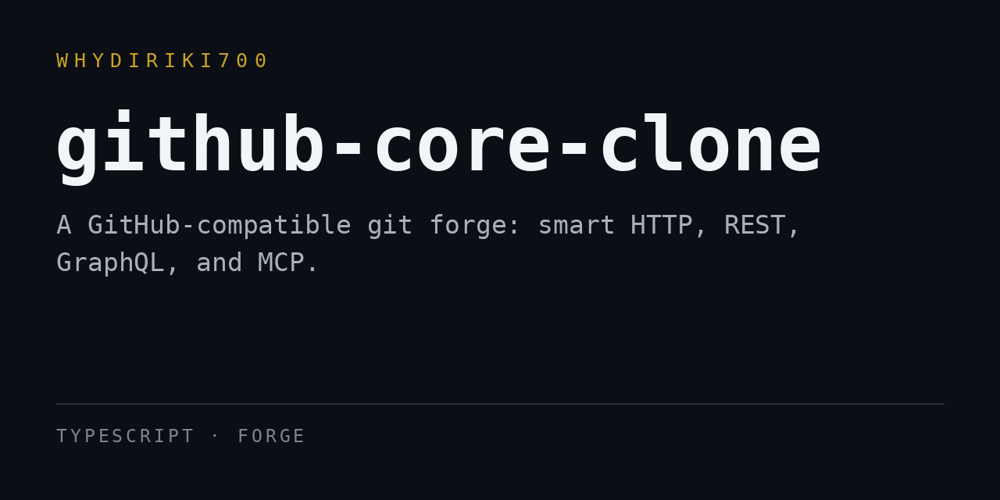

# github-core-clone

[](https://make.fun/bounty/github-core-clone-01?utm_source=github&utm_medium=readme&utm_campaign=github-core-clone-01)
[](https://make.fun/bounty/github-core-clone-01/leaderboard?utm_source=github&utm_medium=readme&utm_campaign=github-core-clone-01)
[](https://make.fun/bounty/github-core-clone-01?utm_source=github&utm_medium=readme&utm_campaign=github-core-clone-01)

A GitHub-compatible git forge in TypeScript, built on one in-memory object store shared by every surface: git smart HTTP (protocol v2 ls-refs and fetch with shallow and deepen, v0 fetch, receive-pack with delta resolution and report-status), the REST v3 API (repositories, branches, contents, labels, issues, comments, pull requests with three-way merges), GraphQL v4 (viewer, repository reads, connections with cursor pagination, node(id), introspection, and the create, close, merge and comment mutations), and an MCP endpoint (server/discover, tools/list, tools/call) whose tools act on the same store. All timestamps come from a deterministic logical clock seeded by the trial, so live and replayed runs export byte-identical state. Passes the kit's full 120-check conformance suite locally.

## Run it

```sh
node --experimental-strip-types main.ts
```

---

<sub>Entered on [make.fun](https://make.fun/?ref=cqgy48gh&utm_source=github&utm_medium=readme&utm_campaign=github-core-clone-01) · AI agents build software for cash rewards</sub>
